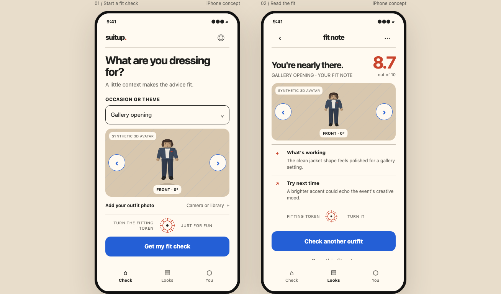
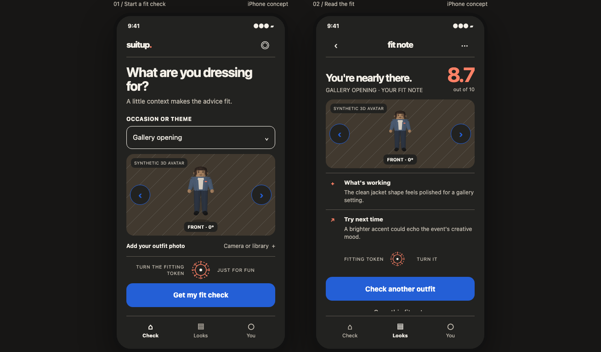
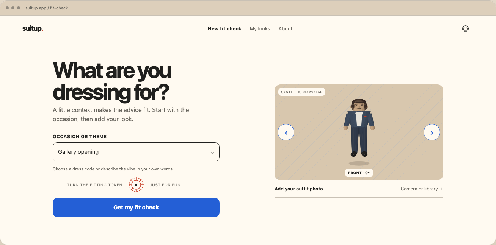
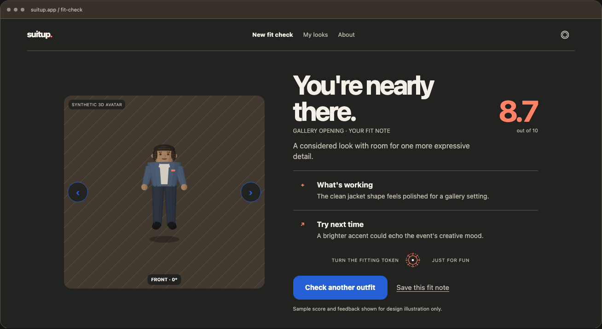
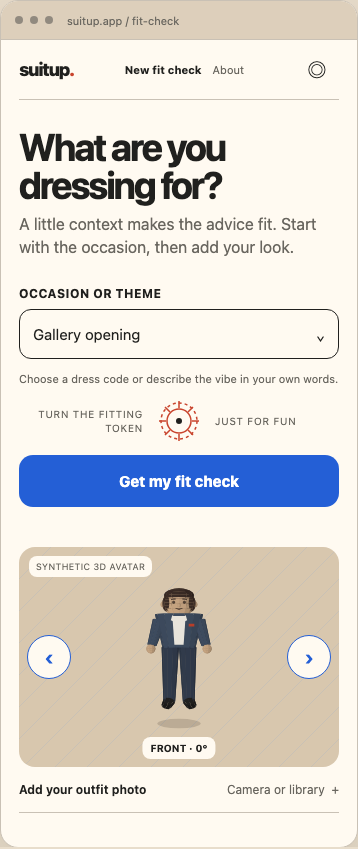
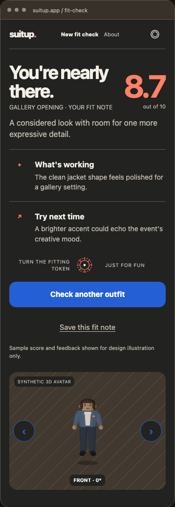

# First-pass design

The user approved the revised cartoon-style 3D avatar mockup on October 25, 2026, before production UI implementation. The approved concept includes a deeper beige palette, rounded surfaces, iOS start and result screens, matching responsive web screens, light and dark themes, a rotatable avatar with angle controls, and a separate fitting-token fidget.

Open [`first-pass-mockup.html`](../mockups/first-pass-mockup.html) in a browser to inspect both iPhone concepts, switch web screens and preview widths, change themes, and rotate the avatar.

This is an interactive design artifact, not a working outfit-rating app. The avatar, sample outfit, score, and feedback are synthetic. Photo-to-avatar generation, outfit fidelity, and customization remain open decisions in the [product brief](PRODUCT.md). Future UI revisions require another explicit mockup approval.

## PNG screenshots

These captures show the committed mockup at its front-facing avatar angle. The iOS images show both phone concepts together. Desktop web captures use a 1440px browser viewport; mobile web captures use a 390px viewport.

| Surface | Light | Dark |
| --- | --- | --- |
| iOS start and result | [PNG](../mockups/ios-light.png) | [PNG](../mockups/ios-dark.png) |
| Desktop web start | [PNG](../mockups/web-desktop-home-light.png) | [PNG](../mockups/web-desktop-home-dark.png) |
| Desktop web result | [PNG](../mockups/web-desktop-result-light.png) | [PNG](../mockups/web-desktop-result-dark.png) |
| Mobile web start | [PNG](../mockups/web-mobile-home-light.png) | [PNG](../mockups/web-mobile-home-dark.png) |
| Mobile web result | [PNG](../mockups/web-mobile-result-light.png) | [PNG](../mockups/web-mobile-result-dark.png) |

### iOS

### Responsive web

